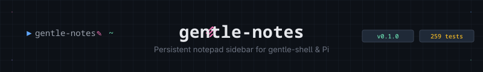

<p align="center">
  
</p>

<p align="center">
  <strong>Persistent notepad sidebar for gentle-shell & Pi — capture thoughts, send them to the chat when ready.</strong>
</p>

<p align="center">
  <a href="https://github.com/andrikonbeat/gentle-notes/actions/workflows/ci.yml">
    
  </a>
  <a href="https://github.com/andrikonbeat/gentle-notes/releases">
    
  </a>
  <a href="https://www.npmjs.com/package/gentle-notes">
    
  </a>
  <a href="LICENSE">
    
  </a>
  <a href="https://nodejs.org/">
    =22.19"/>
  </a>
  <a href="https://github.com/andrikonbeat/gentle-notes/blob/main/package.json">
    
  </a>
  <a href="https://github.com/andrikonbeat/gentle-notes/blob/main/tsconfig.json">
    
  </a>
</p>

<p align="center">
  
</p>

---

## Why gentle-notes?

You're deep in a session with the agent. Ideas keep coming — *"ask about the migration ordering"*, *"the flaky test is probably the fixture"*, *"check the release notes"*. They're not tasks you're committing to *right now* (that's what **Todos** are for). They're thoughts you don't want to lose.

Today you type them in the chat input as a scratchpad. Two problems:
1. **You clutter the input** you actually use for prompts
2. **Accidental sends** interrupt the agent mid-edit

**gentle-notes** adds a **Notes section in the sidebar rail** (right below Todos) and a compact row above the editor in regular mode. Click, type, Enter — saved. Click `➤` when you're ready to send. It's that simple.

---

## Features at a glance

| | |
|---|---|
| **📍 Rail section (fullscreen ≥140 col)** | Lives below Todos in the gentle-shell sidebar. Always visible, always ready. |
| **📝 Inline capture** | Click the field → type → Enter. Text wraps naturally while you type. |
| **➤ Deferred send** | Each note gets a send button. Click when ready. Busy agent? Queued as follow-up, never interrupts. |
| **✓ Sent history** | Sent notes stay struck-through with `✓`, same visual grammar as done Todos. |
| **📂 Fold & collapse** | Collapse the whole block, or fold every note to its first line — copied from Todos card. |
| **📱 Compact mode** | Below breakpoint: one card-styled line above editor with preview + expand. |
| **💾 Persistent per project** | `~/.pi/gentle-ai/notes/<slug>--<hash>.json` — survives restarts, shared across sessions. |
| **⌨️ Keyboard-first** | `/note "text"`, `/notes send`, `alt+n`, `alt+pgup/pgdn` — everything works without a mouse. |
| **🔒 Safe storage** | Owner-only permissions (`0700`/`0600`), corrupt stores preserved (`.corrupt-<ts>`), watcher isolation, input sanitization (C0/C1/bidi stripped, ZWJ kept). |

---

## Quick start

```bash
# Try it instantly (no install):
pi --extension /path/to/gentle-notes

# Permanent for all projects:
ln -s /path/to/gentle-notes ~/.pi/agent/extensions/gentle-notes

# Per-project only:
ln -s /path/to/gentle-notes .pi/extensions/gentle-notes
```

> **No build step needed** — Pi uses jiti, Node strips types. The repo *is* the extension.

---

## Requirements

| | |
|---|---|
| **gentle-shell** | For the rail section, gentle-shell must include `notes` in its sidebar sections. |
| **Stopgap patch** | Until upstream merges it, run `npm run patch:shell-rail` after each gentle-pi update. |

The patch is **18 lines across 3 files** — adds `notes` to the section list and `visibility.notes` type. Everything else lives in this extension (no fork needed, harmless without gentle-shell).

---

## Installation details

### Permanent (recommended)
```bash
ln -s /path/to/gentle-notes ~/.pi/agent/extensions/gentle-notes
```
Loads automatically on every `pi` start. Works across all your projects.

### Per-project
```bash
ln -s /path/to/gentle-notes .pi/extensions/gentle-notes
```
Loads after project trust is granted. Isolated to that project.

### One-off
```bash
pi --extension /path/to/gentle-notes
```
Great for testing. No persistence across restarts.

---

## Keyboard reference

| Command | Action |
|---------|--------|
| `/note "text"` | Capture note from chat input |
| `/notes add "text"` | Same as above (alias) |
| `/notes send` | Open picker, choose note to send |
| `/notes list` | Show all notes |
| `/notes show` | Show last note |
| `/notes restore [id]` | Move sent → pending |
| `/notes delete [id]` | Delete a note |
| `/notes clear` | Delete all (with confirmation) |
| `/notes clear sent` | Delete only sent notes |
| `/notes edit <id>` | Load note into field for editing |
| `/notes collapse\|expand` | Toggle block collapse |
| `/notes fold\|unfold` | Toggle fold-all mode |
| `/notes settings` | Open settings manager |
| `alt+n` | Open settings manager |
| `alt+pgup/pgdn` | Scroll rail/compact list |

> **Manager (`alt+n` / `/notes`)** is settings-only: send target (`chat`/`editor`), clear pending, clear all. No note listing — pickers are separate (`/notes send`, `/notes restore`).

---

## Architecture

```
src/
├── notes-state.ts       # Pure model: add, markSent, clear, summary, validation
├── storage.ts           # Per-project JSON: atomic writes, mutation queue, owner-only perms
├── notes-card.ts        # Pure rendering: glyphs, strikethrough, folding, hit maps
├── sidebar-interop.ts   # Symbol.for interop with gentle-shell rail (no runtime dep)
├── extension.ts         # Pi extension: commands, shortcuts, dialogs, rail card
├── host-contract.ts     # Typed slice of Pi/gentle-shell API used by this extension
├── settings.ts          # Plugin-wide settings (send target) persisted per project
└── card-chrome.ts       # Local replica of gentle-shell card system (NEON/FLOAT)
```

**Zero runtime dependency on gentle-pi** — registers via `Symbol.for` shared state.

---

## Development

```bash
npm run check           # typecheck + tests (what CI runs)
npm test                # node --test "tests/*.test.ts"
npm run typecheck       # tsc --noEmit
npm run verify:package  # pack + assert tarball contents
npm run check:card-parity # byte-parity vs gentle-shell renderCard
npm run patch:shell-rail  # apply/verify rail patch to installed gentle-pi
```

**CI** (`.github/workflows/ci.yml`): Node 22 & 24 × Linux & macOS — same three gates gentle-shell uses for its own PRs.

---

## Project structure

```
gentle-notes/
├── index.ts                 # Extension entry point (directory loadable)
├── package.json
├── tsconfig.json            # strict, erasableSyntaxOnly
├── LICENSE                  # MIT
├── README.md
├── src/                     # 8 modules, ~140KB
├── tests/                   # 40 suites, 259 tests
├── scripts/
│   ├── patch-shell-rail.mjs     # Idempotent rail patch CLI
│   ├── verify-package-files.mjs # Package content verification
│   └── check-card-parity.mjs    # Visual parity test
├── proposal/
│   ├── feature-request.md       # Upstream issue template
│   └── rail-patch/
│       ├── notes-rail.patch     # git diff (18 lines, 3 files)
│       └── README.md
├── odd/
│   └── tasks/gentle-notes.md    # Feature spec + task log
└── docs/assets/               # Banner, divider
```

---

## Contributing

Issues and PRs welcome. For feature work, please open an issue first (issue-first policy, same as gentle-shell).

```bash
# Local verification before PR
npm run check
npm run verify:package
```

---

## Related

- **gentle-shell** — The shell this extends: https://github.com/Gentleman-Programming/gentle-shell
- **Pi** — The coding agent platform: https://github.com/earendil-works/pi-coding-agent
- **Upstream feature request** — https://github.com/Gentleman-Programming/gentle-shell/issues/2513

---

## License

MIT — see [LICENSE](LICENSE).  
Built by [Andrik](https://github.com/andrikonbeat). Part of the Gentleman Programming ecosystem.

<p align="center">
  
</p>

<p align="center">
  <sub>gentle-notes · persistent notepad for the agent you lead</sub>
</p>